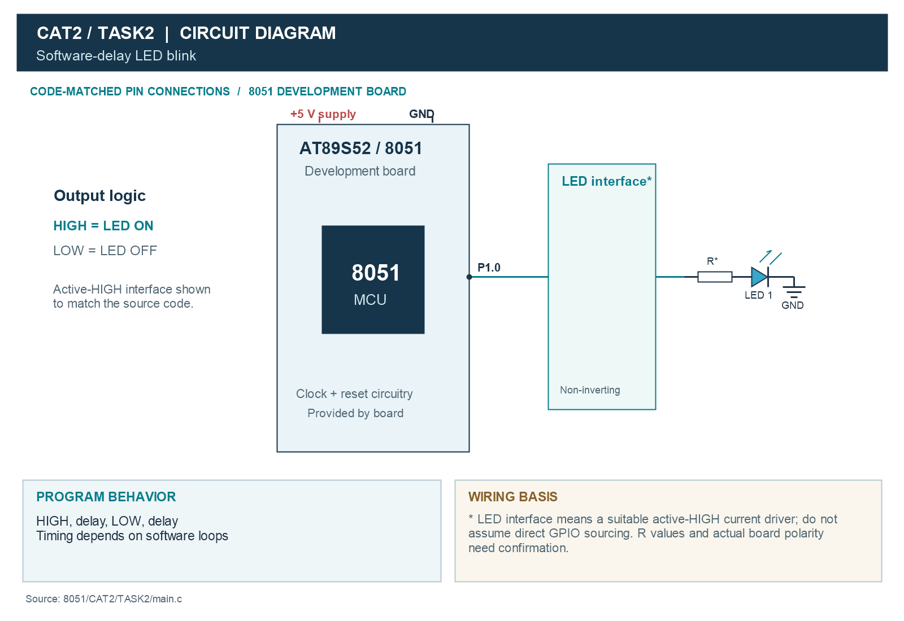

# TASK2 — LED blink using a software delay

## Aim

Toggle an LED using direct GPIO writes and a blocking delay loop.

## Circuit diagram



[Open or download circuit.png](circuit.png)

This diagram follows the port assignments in `main.c`. It is a proposed pin-level connection diagram, not a verified record of the physical lab wiring. Board header numbers, component values and module variants must be checked against the hardware. The LED interface shown is a suitable non-inverting current driver for the code's active-HIGH LED interpretation; it does not establish that such a driver was used in the lab. `R*` denotes a current-limiting resistor whose value is unconfirmed.

## Source and hardware

This description follows the committed [main.c](main.c). It describes expected behavior from source inspection, not a new hardware test. The code uses 8051 register definitions and Keil C51 interrupt syntax.

| Signal | Connection / purpose |
| --- | --- |
| P1.0 | LED output |

Pin names are MCU port bits, not development-board header numbers. Match the board wiring and logic polarity; use current-limiting resistors for LEDs and compatible electrical levels for connected devices.

## Program logic

main() clears P1, sets LED HIGH, calls delay(), sets LED LOW, and calls delay() again. delay() uses two nested loops, each with 500 iterations.

## Pseudocode

```text
REPEAT: LED HIGH; delay; LED LOW; delay.
```

## Expected output and verification

P1.0 alternates HIGH and LOW. An active-HIGH LED alternates ON and OFF.

Build the project, run it on the intended board, and compare the output with this behavior. Record actual timings or observations separately; stored build artifacts alone do not verify the current source on hardware.

## Implementation notes

The blink period is not calibrated: it depends on the oscillator, compiler optimization, and generated instructions. No hardware timer is used. The folder contains TASK2B build outputs and options, but no .uvproj file.

## Files and build steps

- [main.c](main.c): application source.
- [STARTUP.A51](STARTUP.A51): 8051 startup code.
- `Objects/` and `Listings/`: stored build outputs and listings; rebuild before relying on them.

1. Create a Keil C51 project for the actual 8051 device; this folder has no committed .uvproj file. Add main.c and the startup file, avoiding duplicate startup modules.
2. Confirm the selected device, oscillator setting, include paths and output settings against the hardware.
3. Build/rebuild and inspect compiler messages. Generate a HEX file if required by the board programmer.
4. Program the board using its supported programmer, connect the signals above, and check the expected behavior.
