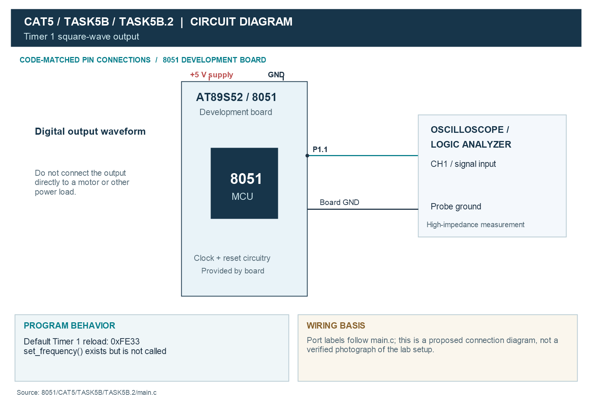

# TASK5B.2 — Timer 1 square-wave generation

## Aim

Toggle P1.1 on Timer 1 interrupts, with a helper for selecting reload values.

## Circuit diagram



[Open or download circuit.png](circuit.png)

This diagram follows the port assignments in `main.c`. It is a proposed pin-level connection diagram, not a verified record of the physical lab wiring. Board header numbers, component values and module variants must be checked against the hardware.

## Source and hardware

This description follows the committed [main.c](main.c). It describes expected behavior from source inspection, not a new hardware test. The code uses 8051 register definitions and Keil C51 interrupt syntax.

| Signal | Connection / purpose |
| --- | --- |
| P1.1 | Square-wave output |

Pin names are MCU port bits, not development-board header numbers. Match the board wiring and logic polarity; use current-limiting resistors for LEDs and compatible electrical levels for connected devices.

## Program logic

Timer 1 runs in mode 1 with default reload 0xFE33. timer1_ISR() reloads the timer and complements OUTPUT. set_frequency() provides modes 1–5 with reloads 0xEE00, 0xFC66, 0xFE33, 0xFF1A and 0xFFA4.

## Pseudocode

```text
INITIALIZE Timer 1 with 0xFE33
ON overflow: reload; invert P1.1
FOREGROUND: empty
```

## Expected output and verification

The committed program generates the default waveform continuously. Each complete waveform period requires two overflow intervals.

Build the project, run it on the intended board, and compare the output with this behavior. Record actual timings or observations separately; stored build artifacts alone do not verify the current source on hardware.

## Implementation notes

set_frequency() is never called in the current main loop. Keypad-controlled frequency selection is only a comment, not an implemented feature. Ignoring overhead, f_out = f_osc / [24 × (65536 − reload)] for a classic 12-clock timer.

For a classic 12-clock 8051 timer, nominal overflow time is `(65536 − reload) × 12 / f_osc`. At 11.0592 MHz, `0xFC66` gives approximately 1 ms and `0xDC00` gives 10 ms before interrupt/reload overhead. Confirm the board oscillator before treating these as real-time measurements.

## Files and build steps

- [main.c](main.c): application source.
- [STARTUP.A51](STARTUP.A51): 8051 startup code.
- [TASK5B.2.uvproj](TASK5B.2.uvproj): Keil project.
- `Objects/` and `Listings/`: stored build outputs and listings; rebuild before relying on them.

1. Open `TASK5B.2.uvproj` in Keil µVision with C51 support.
2. Confirm the selected device, oscillator setting, include paths and output settings against the hardware.
3. Build/rebuild and inspect compiler messages. Generate a HEX file if required by the board programmer.
4. Program the board using its supported programmer, connect the signals above, and check the expected behavior.
