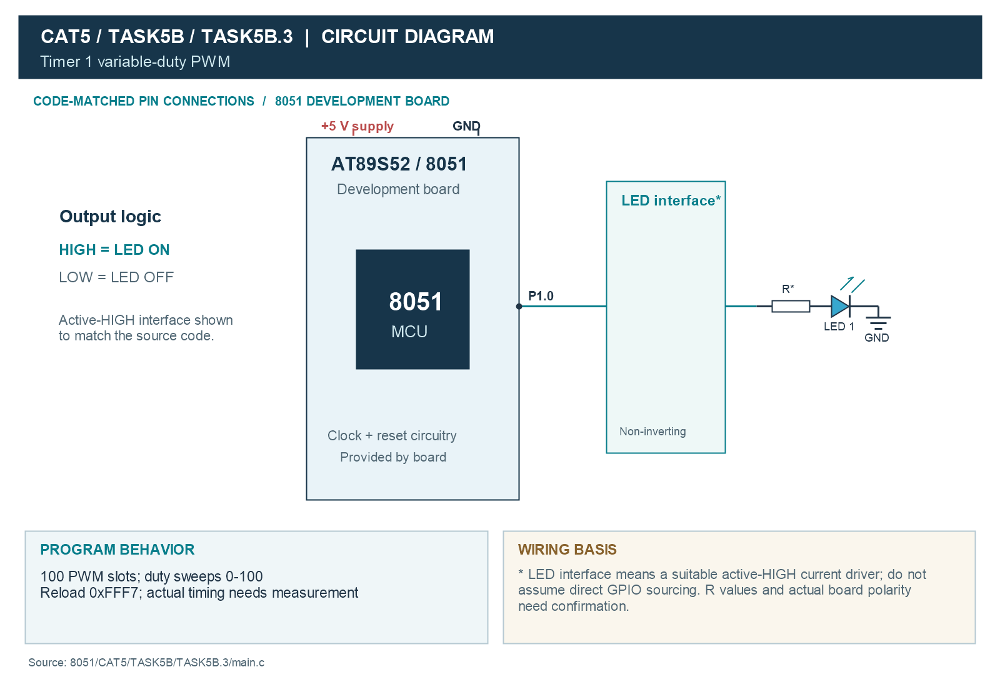

# TASK5B.3 — Timer 1 variable-duty PWM

## Aim

Use Timer 1 interrupts to sweep a software PWM duty value.

## Circuit diagram



[Open or download circuit.png](circuit.png)

This diagram follows the port assignments in `main.c`. It is a proposed pin-level connection diagram, not a verified record of the physical lab wiring. Board header numbers, component values and module variants must be checked against the hardware. The LED interface shown is a suitable non-inverting current driver for the code's active-HIGH LED interpretation; it does not establish that such a driver was used in the lab. `R*` denotes a current-limiting resistor whose value is unconfirmed.

## Source and hardware

This description follows the committed [main.c](main.c). It describes expected behavior from source inspection, not a new hardware test. The code uses 8051 register definitions and Keil C51 interrupt syntax.

| Signal | Connection / purpose |
| --- | --- |
| P1.0 | PWM LED output |

Pin names are MCU port bits, not development-board header numbers. Match the board wiring and logic polarity; use current-limiting resistors for LEDs and compatible electrical levels for connected devices.

## Program logic

Timer 1 mode 1 reloads 0xFFF7. The ISR compares pwm_count with duty, wraps the counter at 100, and changes duty after every 10 PWM cycles. It reverses direction when duty reaches 100 or 0.

## Pseudocode

```text
ON interrupt: output comparison of slot and duty
AFTER 100 slots: reset slot and count cycle
AFTER 10 cycles: adjust duty; reverse at 0 or 100
```

## Expected output and verification

The output duty setting repeatedly sweeps from 0 to 100 and back. This can produce LED fading.

Build the project, run it on the intended board, and compare the output with this behavior. Record actual timings or observations separately; stored build artifacts alone do not verify the current source on hardware.

## Implementation notes

Unlike TASK5B.1, this task uses Timer 1. The nine-count reload interval is very short relative to ISR work, so actual waveform timing must be measured. No keypad duty control is implemented.

## Files and build steps

- [main.c](main.c): application source.
- [STARTUP.A51](STARTUP.A51): 8051 startup code.
- [TASK5B.3.uvproj](TASK5B.3.uvproj): Keil project.
- `Objects/` and `Listings/`: stored build outputs and listings; rebuild before relying on them.

1. Open `TASK5B.3.uvproj` in Keil µVision with C51 support.
2. Confirm the selected device, oscillator setting, include paths and output settings against the hardware.
3. Build/rebuild and inspect compiler messages. Generate a HEX file if required by the board programmer.
4. Program the board using its supported programmer, connect the signals above, and check the expected behavior.
