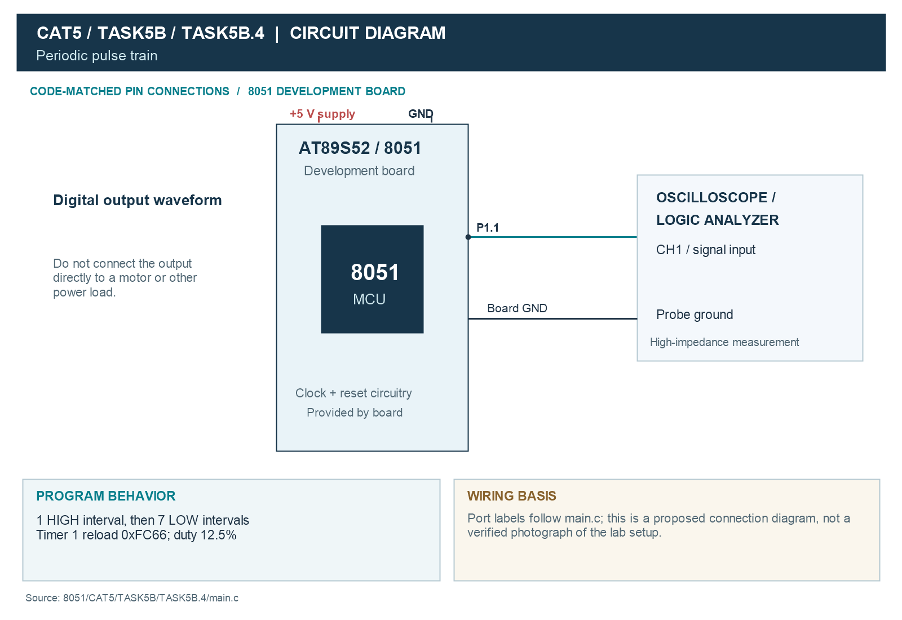

# TASK5B.4 — Periodic pulse train

## Aim

Generate one HIGH interval followed by seven LOW intervals.

## Circuit diagram



[Open or download circuit.png](circuit.png)

This diagram follows the port assignments in `main.c`. It is a proposed pin-level connection diagram, not a verified record of the physical lab wiring. Board header numbers, component values and module variants must be checked against the hardware.

## Source and hardware

This description follows the committed [main.c](main.c). It describes expected behavior from source inspection, not a new hardware test. The code uses 8051 register definitions and Keil C51 interrupt syntax.

| Signal | Connection / purpose |
| --- | --- |
| P1.1 | Pulse output |

Pin names are MCU port bits, not development-board header numbers. Match the board wiring and logic polarity; use current-limiting resistors for LEDs and compatible electrical levels for connected devices.

## Program logic

Timer 1 mode 1 reloads 0xFC66. The ISR sets OUTPUT HIGH only for count=0, otherwise LOW, and wraps count at 8.

## Pseudocode

```text
ON interrupt: reload timer
SET output HIGH if count=0, else LOW
INCREMENT count modulo 8
```

## Expected output and verification

The logical duty ratio is 1/8 (12.5%). With an approximately 1 ms interrupt interval, the pulse is approximately 1 ms HIGH and 7 ms LOW, or about 125 Hz.

Build the project, run it on the intended board, and compare the output with this behavior. Record actual timings or observations separately; stored build artifacts alone do not verify the current source on hardware.

## Implementation notes

These times are nominal, not measured results. The initial output is LOW until the first interrupt.

For a classic 12-clock 8051 timer, nominal overflow time is `(65536 − reload) × 12 / f_osc`. At 11.0592 MHz, `0xFC66` gives approximately 1 ms and `0xDC00` gives 10 ms before interrupt/reload overhead. Confirm the board oscillator before treating these as real-time measurements.

## Files and build steps

- [main.c](main.c): application source.
- [STARTUP.A51](STARTUP.A51): 8051 startup code.
- [TASK5B.4.uvproj](TASK5B.4.uvproj): Keil project.
- `Objects/` and `Listings/`: stored build outputs and listings; rebuild before relying on them.

1. Open `TASK5B.4.uvproj` in Keil µVision with C51 support.
2. Confirm the selected device, oscillator setting, include paths and output settings against the hardware.
3. Build/rebuild and inspect compiler messages. Generate a HEX file if required by the board programmer.
4. Program the board using its supported programmer, connect the signals above, and check the expected behavior.
