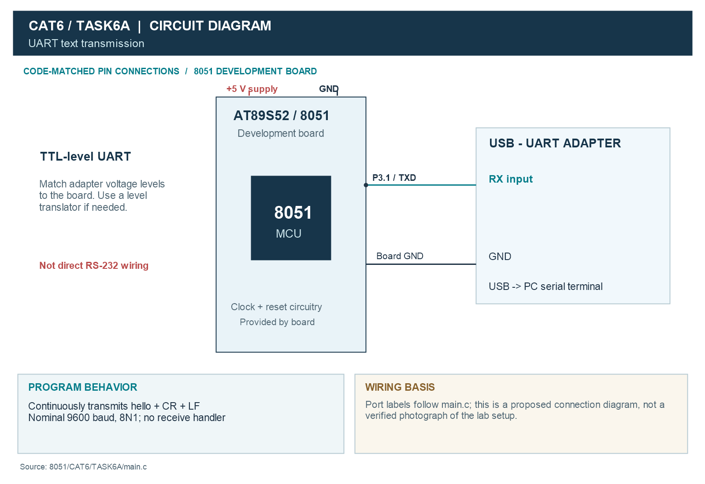

# TASK6A — Interrupt-driven UART text transmission

## Aim

Continuously transmit hello followed by carriage return and newline.

## Circuit diagram



[Open or download circuit.png](circuit.png)

This diagram follows the port assignments in `main.c`. It is a proposed pin-level connection diagram, not a verified record of the physical lab wiring. Board header numbers, component values and module variants must be checked against the hardware.

## Source and hardware

This description follows the committed [main.c](main.c). It describes expected behavior from source inspection, not a new hardware test. The code uses 8051 register definitions and Keil C51 interrupt syntax.

| Signal | Connection / purpose |
| --- | --- |
| P3.1 / TXD | Connect to compatible serial adapter RX |
| GND | Common ground |

Pin names are MCU port bits, not development-board header numbers. Match the board wiring and logic polarity; use current-limiting resistors for LEDs and compatible electrical levels for connected devices.

## Program logic

SCON=0x50 selects 8-bit UART with reception enabled. Timer 1 mode 2 and TH1=0xFD provide the intended baud rate. main() writes the first character to SBUF. Each TI interrupt clears TI and writes the next character; index wraps at 7.

## Pseudocode

```text
CONFIGURE UART and interrupts
WRITE first character
ON transmit complete: advance index, wrap at 7, send next character
```

## Expected output and verification

A terminal displays repeated hello lines, continuously without an application-level pause.

Build the project, run it on the intended board, and compare the output with this behavior. Record actual timings or observations separately; stored build artifacts alone do not verify the current source on hardware.

## Implementation notes

9600 baud assumes 11.0592 MHz, a classic 12-clock timer and SMOD=0; use 8 data bits, no parity, one stop bit. TL1 is not explicitly initialized. Reception is enabled but RI is never handled: incoming data can leave the serial interrupt pending. Use this task as transmit-only unless the receive handler is fixed.

## Files and build steps

- [main.c](main.c): application source.
- [STARTUP.A51](STARTUP.A51): 8051 startup code.
- [TASK6A.uvproj](TASK6A.uvproj): Keil project.
- `Objects/` and `Listings/`: stored build outputs and listings; rebuild before relying on them.

1. Open `TASK6A.uvproj` in Keil µVision with C51 support.
2. Confirm the selected device, oscillator setting, include paths and output settings against the hardware.
3. Build/rebuild and inspect compiler messages. Generate a HEX file if required by the board programmer.
4. Program the board using its supported programmer, connect the signals above, and check the expected behavior.
