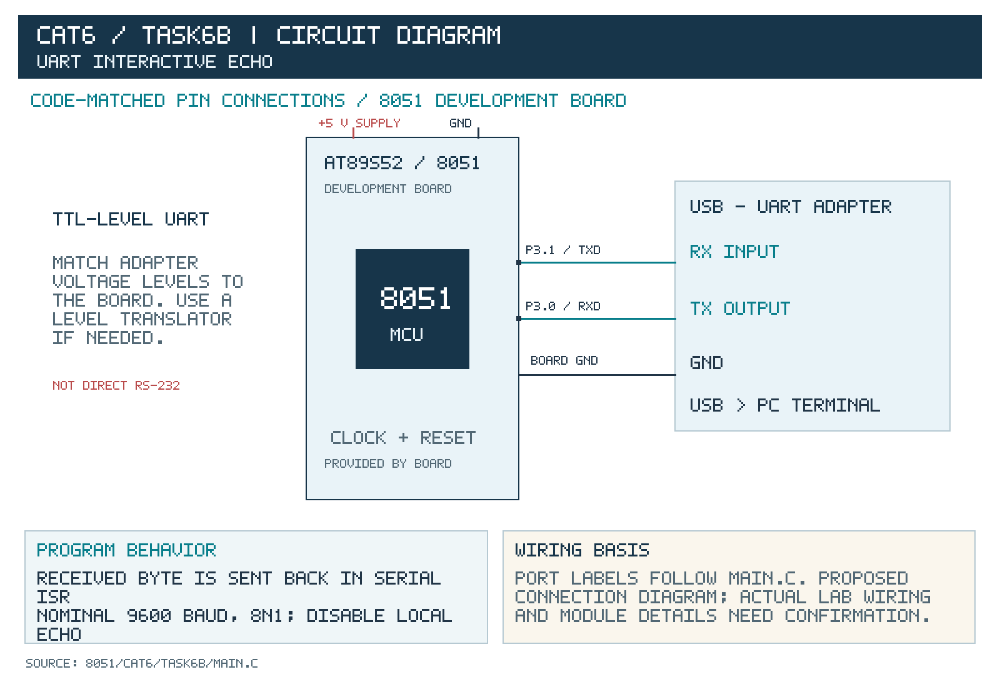

# TASK6B — Interrupt-driven UART echo

## Aim

Return each received UART byte to the terminal.

## Circuit diagram



[Open or download circuit.png](circuit.png)

This diagram follows the port assignments in `main.c`. It is a proposed pin-level connection diagram, not a verified record of the physical lab wiring. Board header numbers, component values and module variants must be checked against the hardware.

## Source and hardware

This description follows the committed [main.c](main.c). It describes expected behavior from source inspection, not a new hardware test. The code uses 8051 register definitions and Keil C51 interrupt syntax.

| Signal | Connection / purpose |
| --- | --- |
| P3.0 / RXD | Connect to compatible serial adapter TX |
| P3.1 / TXD | Connect to compatible serial adapter RX |
| GND | Common ground |

Pin names are MCU port bits, not development-board header numbers. Match the board wiring and logic polarity; use current-limiting resistors for LEDs and compatible electrical levels for connected devices.

## Program logic

init() selects SCON=0x50, Timer 1 mode 2, TH1=0xFD, and enables serial/global interrupts. The serial ISR clears RI, reads SBUF and writes the received byte back to SBUF. It separately clears TI.

## Pseudocode

```text
INITIALIZE UART
ON receive: read byte; transmit same byte
ON transmit complete: clear TI
```

## Expected output and verification

Typing a character in a terminal should return that character. Disable terminal local echo to avoid displaying both a locally generated and a returned copy.

Build the project, run it on the intended board, and compare the output with this behavior. Record actual timings or observations separately; stored build artifacts alone do not verify the current source on hardware.

## Implementation notes

The intended terminal setting is 9600 baud, 8N1, assuming 11.0592 MHz and SMOD=0. There is no transmit queue or explicit busy check, so this is a simple interactive echo example, not a guaranteed lossless high-throughput relay. TL1 is not explicitly initialized.

## Files and build steps

- [main.c](main.c): application source.
- [STARTUP.A51](STARTUP.A51): 8051 startup code.
- [TASK6B.uvproj](TASK6B.uvproj): Keil project.
- `Objects/` and `Listings/`: stored build outputs and listings; rebuild before relying on them.

1. Open `TASK6B.uvproj` in Keil µVision with C51 support.
2. Confirm the selected device, oscillator setting, include paths and output settings against the hardware.
3. Build/rebuild and inspect compiler messages. Generate a HEX file if required by the board programmer.
4. Program the board using its supported programmer, connect the signals above, and check the expected behavior.
