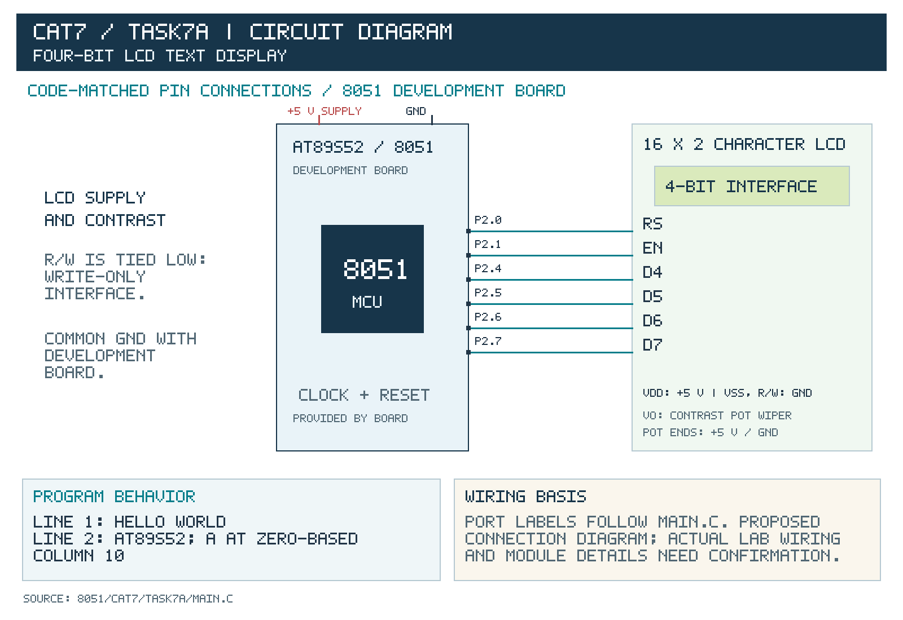

# TASK7A — Four-bit LCD text display

## Aim

Initialize a two-line character LCD and display fixed strings and one character.

## Circuit diagram



[Open or download circuit.png](circuit.png)

This diagram follows the port assignments in `main.c`. It is a proposed pin-level connection diagram, not a verified record of the physical lab wiring. Board header numbers, component values and module variants must be checked against the hardware. LCD power, contrast and backlight connections depend on the module; the diagram shows the conventional 5 V, write-only interface.

## Source and hardware

This description follows the committed [main.c](main.c). It describes expected behavior from source inspection, not a new hardware test. The code uses 8051 register definitions and Keil C51 interrupt syntax.

| Signal | Connection / purpose |
| --- | --- |
| P2.0 | LCD RS |
| P2.1 | LCD EN |
| P2.4–P2.7 | LCD D4–D7 |
| LCD R/W | Ground for write-only operation |

Pin names are MCU port bits, not development-board header numbers. Match the board wiring and logic polarity; use current-limiting resistors for LEDs and compatible electrical levels for connected devices.

## Program logic

lcd_nibble() writes the upper nibble of P2 while preserving the lower bits and pulses EN. lcd_cmd()/lcd_data() send each byte in two nibbles. lcd_init() selects 4-bit, two-line operation; lcd_goto() uses row addresses 0x80/0xC0. main() displays the text once.

## Pseudocode

```text
INITIALIZE LCD
ROW 0, COL 0: print HELLO WORLD
ROW 1, COL 0: print AT89S52
ROW 1, COL 10: print A
```

## Expected output and verification

The first line shows HELLO WORLD. The second line shows AT89S52 and A at zero-based column 10.

Build the project, run it on the intended board, and compare the output with this behavior. Record actual timings or observations separately; stored build artifacts alone do not verify the current source on hardware.

## Implementation notes

The driver also contains lcd_print_number() and lcd_clear(), but main() does not call them. Delays are software loops rather than calibrated milliseconds. Configure power, contrast and backlight according to the actual LCD module.

## Files and build steps

- [main.c](main.c): application source.
- [STARTUP.A51](STARTUP.A51): 8051 startup code.
- [TASK7A.uvproj](TASK7A.uvproj): Keil project.
- `Objects/` and `Listings/`: stored build outputs and listings; rebuild before relying on them.

1. Open `TASK7A.uvproj` in Keil µVision with C51 support.
2. Confirm the selected device, oscillator setting, include paths and output settings against the hardware.
3. Build/rebuild and inspect compiler messages. Generate a HEX file if required by the board programmer.
4. Program the board using its supported programmer, connect the signals above, and check the expected behavior.
