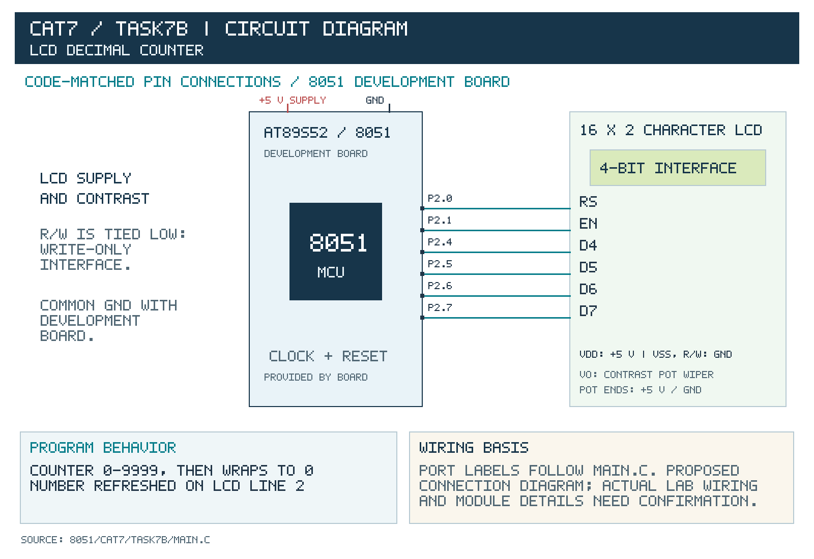

# TASK7B — LCD decimal counter

## Aim

Display an incrementing decimal counter on a two-line LCD.

## Circuit diagram



[Open or download circuit.png](circuit.png)

This diagram follows the port assignments in `main.c`. It is a proposed pin-level connection diagram, not a verified record of the physical lab wiring. Board header numbers, component values and module variants must be checked against the hardware. LCD power, contrast and backlight connections depend on the module; the diagram shows the conventional 5 V, write-only interface.

## Source and hardware

This description follows the committed [main.c](main.c). It describes expected behavior from source inspection, not a new hardware test. The code uses 8051 register definitions and Keil C51 interrupt syntax.

| Signal | Connection / purpose |
| --- | --- |
| P2.0 | LCD RS |
| P2.1 | LCD EN |
| P2.4–P2.7 | LCD D4–D7 |
| LCD R/W | Ground for write-only operation |

Pin names are MCU port bits, not development-board header numbers. Match the board wiring and logic polarity; use current-limiting resistors for LEDs and compatible electrical levels for connected devices.

## Program logic

The four-bit driver sends two nibbles per byte. lcd_print_number() extracts decimal digits with modulo/division and prints them in reverse extraction order, with explicit handling for zero. main() writes Counter Value: on row 0 and repeatedly clears the number field before displaying count on row 1.

## Pseudocode

```text
INITIALIZE LCD and heading
REPEAT: write Value: and clear five positions
MOVE to row 1, column 7; print count
INCREMENT; wrap after 9999; delay(500)
```

## Expected output and verification

The display counts 0, 1, 2, …, 9999, then returns to 0 without leaving stale digits.

Build the project, run it on the intended board, and compare the output with this behavior. Record actual timings or observations separately; stored build artifacts alone do not verify the current source on hardware.

## Implementation notes

delay(500) is a software-loop argument, not verified 500 ms timing. LCD refresh and formatting add execution time. No timer interrupt drives the count.

## Files and build steps

- [main.c](main.c): application source.
- [STARTUP.A51](STARTUP.A51): 8051 startup code.
- [TASK7B.uvproj](TASK7B.uvproj): Keil project.
- `Objects/` and `Listings/`: stored build outputs and listings; rebuild before relying on them.

1. Open `TASK7B.uvproj` in Keil µVision with C51 support.
2. Confirm the selected device, oscillator setting, include paths and output settings against the hardware.
3. Build/rebuild and inspect compiler messages. Generate a HEX file if required by the board programmer.
4. Program the board using its supported programmer, connect the signals above, and check the expected behavior.
