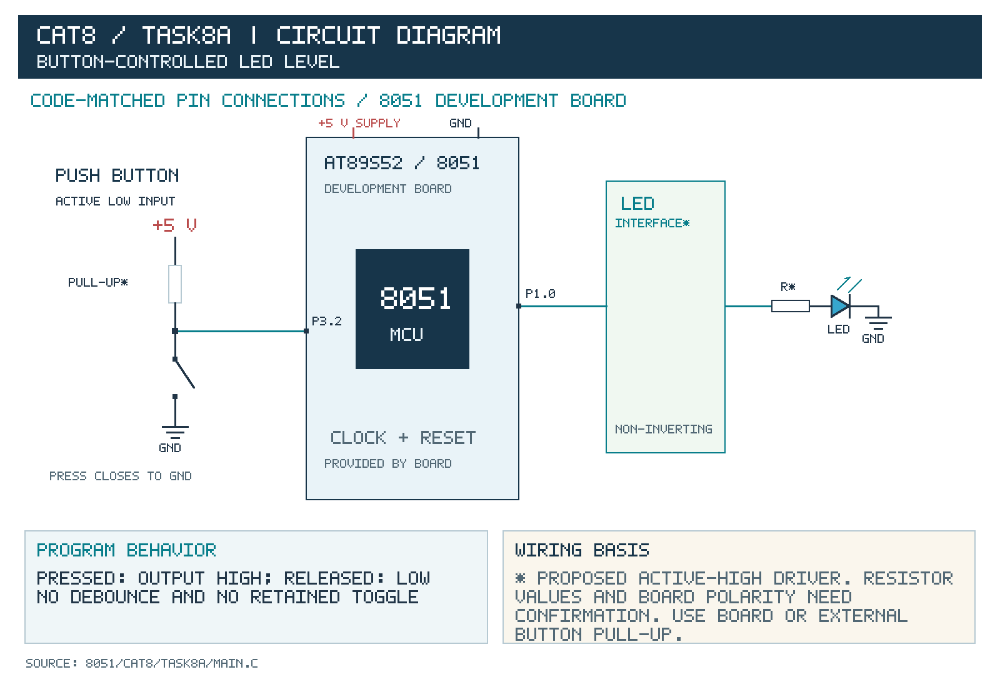

# TASK8A — Button-controlled LED level

## Aim

Make the LED output follow an active-LOW button press.

## Circuit diagram



[Open or download circuit.png](circuit.png)

This diagram follows the port assignments in `main.c`. It is a proposed pin-level connection diagram, not a verified record of the physical lab wiring. Board header numbers, component values and module variants must be checked against the hardware. The LED interface shown is a suitable non-inverting current driver for the code's active-HIGH LED interpretation; it does not establish that such a driver was used in the lab. `R*` denotes a current-limiting resistor whose value is unconfirmed. The button connects P3.2 to ground when pressed; the pull-up may be provided by the board or an external resistor.

## Source and hardware

This description follows the committed [main.c](main.c). It describes expected behavior from source inspection, not a new hardware test. The code uses 8051 register definitions and Keil C51 interrupt syntax.

| Signal | Connection / purpose |
| --- | --- |
| P3.2 | Active-LOW push button |
| P1.0 | LED output |

Pin names are MCU port bits, not development-board header numbers. Match the board wiring and logic polarity; use current-limiting resistors for LEDs and compatible electrical levels for connected devices.

## Program logic

BUTTON=1 releases the input pin for reading; LED starts LOW. The foreground loop continuously reads BUTTON, writes LED HIGH when pressed, and LOW when released.

## Pseudocode

```text
REPEAT: if BUTTON LOW, LED HIGH; otherwise LED LOW.
```

## Expected output and verification

An active-HIGH LED is ON only while the button is held.

Build the project, run it on the intended board, and compare the output with this behavior. Record actual timings or observations separately; stored build artifacts alone do not verify the current source on hardware.

## Implementation notes

This folder contains 8051 code using reg52.h, not STM32 firmware. There is no debounce, interrupt handling or retained toggle state.

## Files and build steps

- [main.c](main.c): application source.
- [STARTUP.A51](STARTUP.A51): 8051 startup code.
- [TASK8A.uvproj](TASK8A.uvproj): Keil project.
- `Objects/` and `Listings/`: stored build outputs and listings; rebuild before relying on them.

1. Open `TASK8A.uvproj` in Keil µVision with C51 support.
2. Confirm the selected device, oscillator setting, include paths and output settings against the hardware.
3. Build/rebuild and inspect compiler messages. Generate a HEX file if required by the board programmer.
4. Program the board using its supported programmer, connect the signals above, and check the expected behavior.
