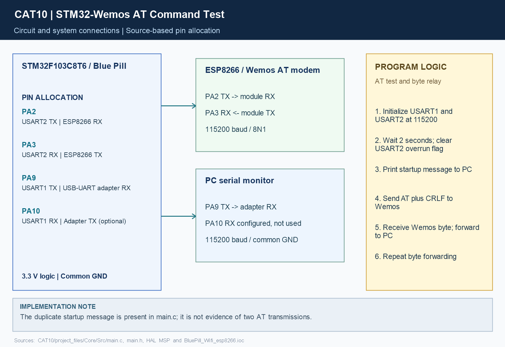
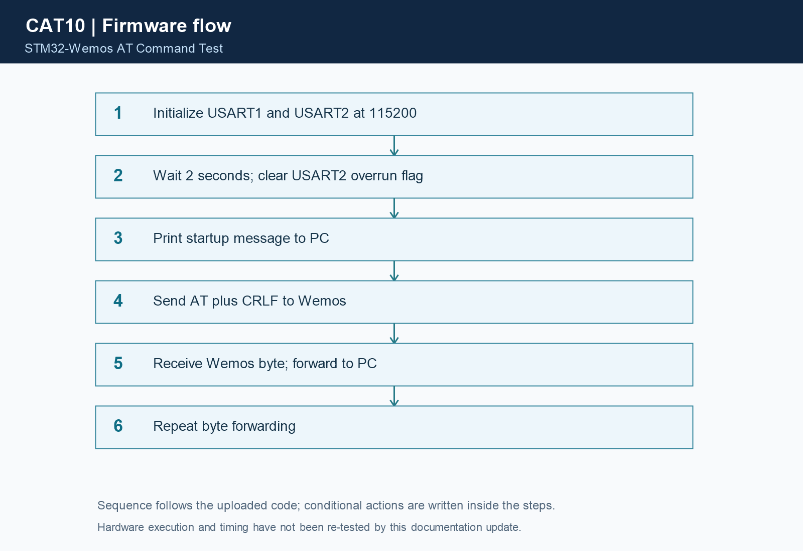

# Continuous Lab Evaluation 10: STM32-Wemos AT Command Test

## 1. Experiment Title

STM32-Wemos AT Command Test using STM32F103C8T6 / Blue Pill.

## 2. Aim

Sends one AT command to an ESP8266 running AT firmware, then forwards each received modem byte to a PC serial monitor. This is a connectivity test, not a Wi-Fi join, MQTT client or HTTP server.

## 3. Hardware Components

- STM32F103C8T6 / Blue Pill
- ST-LINK or onboard ST-LINK programmer
- USB cable and connections shown in the pin table
- ESP8266/Wemos board with a stable supply appropriate to its power input
- USB-UART adapter with 3.3 V logic and serial terminal

## 4. Software Tools

- STM32CubeMX: `BluePill_Wifi_esp8266.ioc`
- Keil MDK-ARM: `MDK-ARM/BluePill_Wifi_esp8266.uvprojx`
- STM32 HAL and CMSIS sources included in the project

## 5. Theory

GPIO and UART behavior depends on pin mode and active level. A logical HIGH or LOW describes the electrical output; visible LED state also depends on its wiring. HAL calls provide peripheral access while SysTick supplies software timing.

## 6. Actual Pin Configuration

| Pin | Function | Connection | Purpose |
|---|---|---|---|
| PA2 | USART2 TX | ESP8266 RX | AT command, 115200 8N1 |
| PA3 | USART2 RX | ESP8266 TX | Modem response, 115200 8N1 |
| PA9 | USART1 TX | USB-UART adapter RX | PC monitor, 115200 8N1 |
| PA10 | USART1 RX | Adapter TX (optional) | Configured; not read by application |
| GND | Ground | All connected devices | Common logic reference |

The connections are derived from the source and configuration, rather than a photographed lab assembly. Check board routing and module power pins before wiring. MCU port labels are not connector pin numbers.

## 7. Circuit Diagram



[Open circuit diagram](circuit.png)


## 8. CubeMX / Peripheral Configuration

- System clock: Internal HSI 8 MHz; PLL disabled.
- Configuration: [BluePill_Wifi_esp8266.ioc](BluePill_Wifi_esp8266.ioc).
- Peripheral assignments and operational rates are listed above; the actual initialization in `main.c` is the basis for runtime settings.

1. Open [BluePill_Wifi_esp8266.uvprojx](MDK-ARM/BluePill_Wifi_esp8266.uvprojx) with the matching STM32 device pack installed.
2. Keep `Core/`, `Drivers/`, `MDK-ARM/` and the IOC together. The reorganization preserves these internal relative paths.
3. Check the device and clock settings, build, and review compiler/linker diagnostics. Existing output files may predate the source.
4. Program the intended board using ST-LINK. Make connections from the pin table and confirm the stated logic levels.
5. Compare the observed behavior with the expected output below.

## 9. Key APIs Used

- `HAL_UART_Receive()`
- `HAL_UART_Transmit()`
- `HAL_Delay()`
- `__HAL_UART_CLEAR_OREFLAG()`

## 10. Source Code Logic

After a 2-second wait the code clears the USART2 overrun flag, prints a startup message on USART1, sends AT followed by CRLF on USART2, and prints the same startup message again. The main loop blocks waiting for one USART2 byte and forwards it through USART1.

Read [main.c](Core/Src/main.c) for the complete implementation.

## 11. Algorithm

1. Initialize USART1 and USART2 at 115200.
2. Wait 2 seconds; clear USART2 overrun flag.
3. Print startup message to PC.
4. Send AT plus CRLF to Wemos.
5. Receive Wemos byte; forward to PC.
6. Repeat byte forwarding.

## 12. Pseudocode

```text
1. Initialize USART1 and USART2 at 115200
2. Wait 2 seconds; clear USART2 overrun flag
3. Print startup message to PC
4. Send AT plus CRLF to Wemos
5. Receive Wemos byte; forward to PC
6. Repeat byte forwarding
```

## 13. Flowchart



## 14. Expected Output

The PC should show the startup banner twice. An AT-ready module at the matching baud rate is expected to respond with OK, with possible command echo depending on its configuration.

## 15. Actual Observations

No new physical test was performed for this update. The behavior described here is inferred from the uploaded source. Add measured readings, terminal captures and board-specific observations after running the project.

## 16. Troubleshooting

1. Check board power, shared GND and the exact MCU port names before interpreting a missing output.
2. Open the matching project and rebuild; do not assume stored build artifacts reflect the current source.
3. For garbled serial data, match the documented baud rate and 8N1 settings, cross TX to RX, and check voltage compatibility.

## 17. Limitations and Implementation Notes

- The duplicate startup message is present in main.c; it is not evidence of two AT transmissions.
- There is no PC-to-Wemos forwarding loop. Typing in the PC terminal will not send arbitrary AT commands through this firmware.
- The blocking HAL_MAX_DELAY receive can wait indefinitely if the module stays silent.
- Use compatible AT firmware and a stable supply appropriate to the actual Wemos/module power input.

## 18. Result and Verification

Reviewed against the uploaded `Core/Src/main.c`, `Core/Inc/main.h`, `Core/Src/stm32f1xx_hal_msp.c` and `BluePill_Wifi_esp8266.ioc`. This documentation update does not claim a new Keil build, hardware run, measured waveform or successful network connection.

The uploaded program implements the behavior described above. Hardware success remains to be confirmed against the expected output.

## 19. Viva Questions with Answers

1. **Which UART connects to Wemos?**  
   USART2 on PA2 and PA3.

2. **Why does the loop wait indefinitely?**  
   HAL_UART_Receive is called with HAL_MAX_DELAY.

3. **Does this project connect to Wi-Fi?**  
   No. Its only modem command is AT.

## 20. File Descriptions

| File / folder | Purpose |
|---|---|
| [Core/Src/main.c](Core/Src/main.c) | Main application and peripheral initialization |
| [Core/Inc/main.h](Core/Inc/main.h) | Public declarations and GPIO macros |
| `Core/Src/*hal_msp.c` | Peripheral clocks and alternate-function GPIO setup |
| [BluePill_Wifi_esp8266.ioc](BluePill_Wifi_esp8266.ioc) | STM32CubeMX configuration |
| [MDK-ARM/BluePill_Wifi_esp8266.uvprojx](MDK-ARM/BluePill_Wifi_esp8266.uvprojx) | Keil project |
| `Drivers/` | Included HAL and CMSIS dependencies |

[Return to task overview](../README.md)
