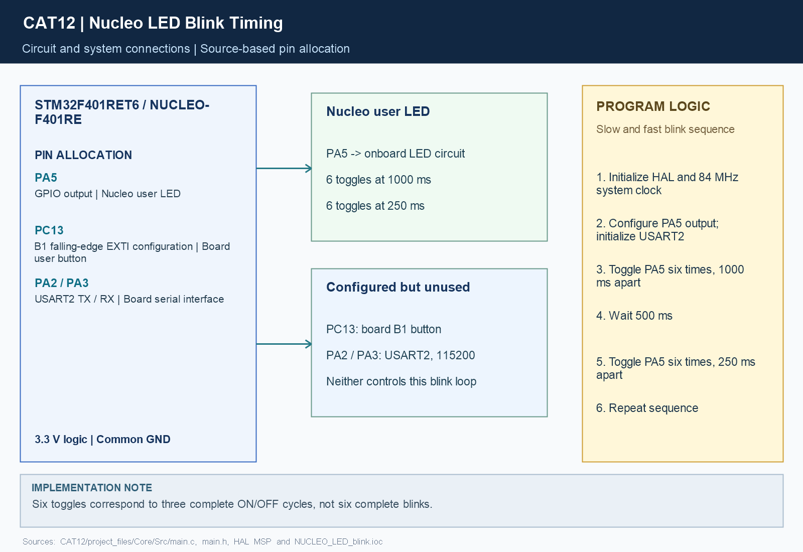

# Continuous Lab Evaluation 12: Nucleo LED Blink Timing

## 1. Overview

Repeats six slow LED toggles, a 500 ms pause, and six fast LED toggles on PA5. The uploaded program is a timed blink sequence rather than button-controlled toggling.

## 2. Objective

- Initialize HAL and 84 MHz system clock.
- Configure PA5 output; initialize USART2.
- Toggle PA5 six times, 1000 ms apart.

## 3. Hardware and Software Used

- STM32F401RET6 / NUCLEO-F401RE
- ST-LINK or onboard ST-LINK programmer
- USB cable and connections shown in the pin table
- STM32CubeMX and Keil MDK-ARM; see the [detailed report](project_files/README.md) for build setup.

## 4. Main Peripherals Used

| Pin | Function | Connection | Purpose |
|---|---|---|---|
| PA5 | GPIO output | Nucleo user LED | Toggled by firmware |
| PC13 | B1 falling-edge EXTI configuration | Board user button | Configured; not used by the blink loop |
| PA2 / PA3 | USART2 TX / RX | Board serial interface | 115200 8N1 configured, no application traffic |
| GND | Ground | All connected devices | Common logic reference |

## 5. Summary of Actual Implementation

Each slow iteration toggles PA5 and delays 1000 ms; six iterations follow. HAL_Delay(500) adds a pause. A second six-iteration loop toggles with a 250 ms delay. PA5 starts LOW, and six toggles return it to its previous level.

## 6. Circuit and Pin Reference

[Open circuit diagram](circuit.png)

System clock: HSI 16 MHz through PLL M=16, N=336, P=4 gives 84 MHz; APB1 42 MHz, APB2 84 MHz.

## 7. Links to Artifacts and Detailed Documentation

- [Circuit Diagram](circuit.png)
- [Firmware Flowchart](project_files/flowchart.png)

- [Detailed Project Engineering Report](project_files/README.md)
- [Primary Application Source](project_files/Core/Src/main.c)
- [STM32CubeMX Configuration](project_files/NUCLEO_LED_blink.ioc)
- [Keil Project](project_files/MDK-ARM/NUCLEO_LED_blink.uvprojx)

## 8. Key Observations

- Six toggles correspond to three complete ON/OFF cycles, not six complete blinks.
- The nominal loop duration is 8000 ms plus execution overhead: 6000 + 500 + 1500 ms.
- PC13 and USART2 are configured but do not affect the shown application loop.

## 9. Learning Outcomes

- Explain the pin assignments and the program sequence from the actual source.
- Distinguish configured peripherals from those used in the application loop.
- Compare physical output with the [expected behavior](project_files/README.md#14-expected-output).

## 10. Verification Note

Source and configuration were inspected; the firmware was not rebuilt or tested on a board during this documentation update. Diagrams describe code-based connections and explicitly noted hardware assumptions.

## 11. Conclusion

The PA5 LED alternates slowly for three full cycles, pauses, then alternates quickly for three full cycles. The pattern repeats.
