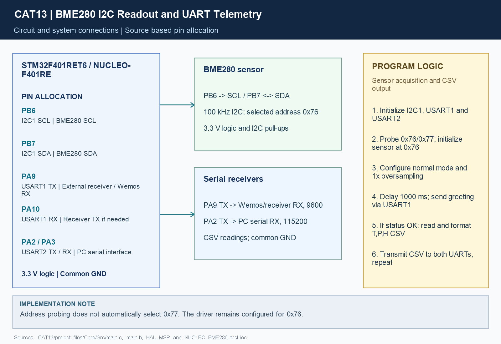

# Continuous Lab Evaluation 13: BME280 I2C Readout and UART Telemetry

## 1. Overview

Uses the Bosch BME280 driver over I2C1 and sends temperature, pressure and humidity as comma-separated text. USART1 is used for an external receiver and USART2 for the PC.

## 2. Objective

- Initialize I2C1, USART1 and USART2.
- Probe 0x76/0x77; initialize sensor at 0x76.
- Configure normal mode and 1x oversampling.

## 3. Hardware and Software Used

- STM32F401RET6 / NUCLEO-F401RE
- ST-LINK or onboard ST-LINK programmer
- USB cable and connections shown in the pin table
- BME280 breakout with compatible 3.3 V logic; I2C pull-ups provided by module or external circuit
- STM32CubeMX and Keil MDK-ARM; see the [detailed report](project_files/README.md) for build setup.

## 4. Main Peripherals Used

| Pin | Function | Connection | Purpose |
|---|---|---|---|
| PB6 | I2C1 SCL | BME280 SCL | 100 kHz clock |
| PB7 | I2C1 SDA | BME280 SDA | Bidirectional data |
| PA9 | USART1 TX | External receiver / Wemos RX | 9600 8N1 CSV and greeting |
| PA10 | USART1 RX | Receiver TX if needed | Configured; not read by loop |
| PA2 / PA3 | USART2 TX / RX | PC serial interface | 115200 8N1; CSV transmitted on PA2 |
| GND | Ground | All connected devices | Common logic reference |

## 5. Summary of Actual Implementation

The code probes 0x76 and 0x77, but selects 0x76 for the driver. It configures 1× oversampling, filtering off, 1000 ms standby and normal mode. Each iteration delays 1000 ms, sends HELLO FROM NUCLEO on USART1, reads compensated data when rslt is OK, converts pressure to hPa, and formats temperature,pressure,humidity with two decimal places. Valid formatted data is sent to both UARTs.

## 6. Circuit and Pin Reference

[Open circuit diagram](circuit.png)

System clock: HSI-derived 84 MHz PLL clock; APB1 42 MHz and APB2 84 MHz.

## 7. Links to Artifacts and Detailed Documentation

- [Circuit Diagram](circuit.png)
- [Firmware Flowchart](project_files/flowchart.png)

- [Detailed Project Engineering Report](project_files/README.md)
- [Primary Application Source](project_files/Core/Src/main.c)
- [STM32CubeMX Configuration](project_files/NUCLEO_BME280_test.ioc)
- [Keil Project](project_files/MDK-ARM/NUCLEO_BME280_test.uvprojx)

## 8. Key Observations

- Address probing does not automatically select 0x77. The driver remains configured for 0x76.
- The IOC does not record the explicit 9600 baud override for USART1, while main.c does. Preserve/check 9600 if regenerating code.
- After a failed read, rslt remains nonzero and the outer condition skips subsequent reads; no recovery is implemented in this file.
- The CSV variable name mqttData does not mean this STM32 program publishes MQTT. No broker connection is present in this task.

## 9. Learning Outcomes

- Explain the pin assignments and the program sequence from the actual source.
- Distinguish configured peripherals from those used in the application loop.
- Compare physical output with the [expected behavior](project_files/README.md#14-expected-output).

## 10. Verification Note

Source and configuration were inspected; the firmware was not rebuilt or tested on a board during this documentation update. Diagrams describe code-based connections and explicitly noted hardware assumptions.

## 11. Conclusion

USART1 sends `HELLO FROM NUCLEO` and, on successful reads, a line shaped like `<temperature_C>,<pressure_hPa>,<humidity_percent>`. USART2 sends the CSV readings. Actual measurements require hardware testing.
