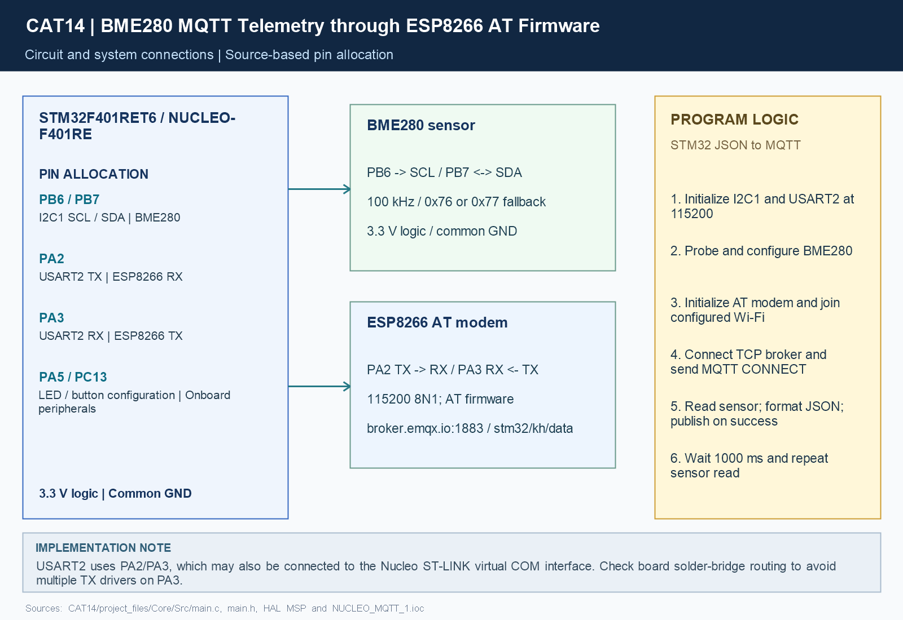
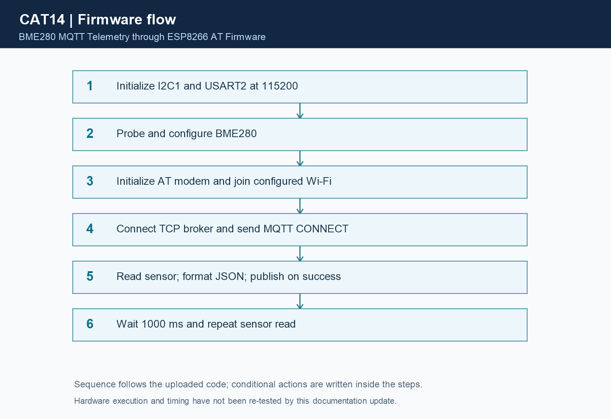

# Continuous Lab Evaluation 14: BME280 MQTT Telemetry through ESP8266 AT Firmware

## 1. Experiment Title

BME280 MQTT Telemetry through ESP8266 AT Firmware using STM32F401RET6 / NUCLEO-F401RE.

## 2. Aim

Reads BME280 data, builds JSON on the STM32, and uses ESPLib to send MQTT packets through an ESP8266 AT modem over USART2.

## 3. Hardware Components

- STM32F401RET6 / NUCLEO-F401RE
- ST-LINK or onboard ST-LINK programmer
- USB cable and connections shown in the pin table
- BME280 breakout with compatible 3.3 V logic; I2C pull-ups provided by module or external circuit
- ESP8266/Wemos board with a stable supply appropriate to its power input

## 4. Software Tools

- STM32CubeMX: `NUCLEO_MQTT_1.ioc`
- Keil MDK-ARM: `MDK-ARM/NUCLEO_MQTT_1.uvprojx`
- STM32 HAL and CMSIS sources included in the project

## 5. Theory

The BME280 driver converts raw sensor data using calibration parameters. I2C1 reads/writes registers through HAL adapter functions. Firmware treats temperature as degrees C, divides pressure in Pa by 100 for hPa, and uses relative humidity in percent. I2C pull-ups and compatible voltage levels are required. MQTT then transports an application payload to a named topic through a broker. CAT14 constructs packets on STM32 using an AT modem; CAT15 delegates JSON validation and MQTT to the Wemos sketch.

## 6. Actual Pin Configuration

| Pin | Function | Connection | Purpose |
|---|---|---|---|
| PB6 / PB7 | I2C1 SCL / SDA | BME280 | 100 kHz; 0x76 or fallback 0x77 |
| PA2 | USART2 TX | ESP8266 RX | 115200 8N1 commands and MQTT packet data |
| PA3 | USART2 RX | ESP8266 TX | AT responses |
| PA5 / PC13 | LED / button configuration | Onboard peripherals | Not used by telemetry loop |
| GND | Ground | All connected devices | Common logic reference |

The connections are derived from the source and configuration, rather than a photographed lab assembly. Check board routing and module power pins before wiring. MCU port labels are not connector pin numbers.

## 7. Circuit Diagram



[Open circuit diagram](circuit.png)


## 8. CubeMX / Peripheral Configuration

- System clock: HSI-derived 84 MHz PLL clock; APB1 42 MHz and APB2 84 MHz.
- Configuration: [NUCLEO_MQTT_1.ioc](NUCLEO_MQTT_1.ioc).
- Peripheral assignments and operational rates are listed above; the actual initialization in `main.c` is the basis for runtime settings.

1. Open [NUCLEO_MQTT_1.uvprojx](MDK-ARM/NUCLEO_MQTT_1.uvprojx) with the matching STM32 device pack installed.
2. Keep `Core/`, `Drivers/`, `MDK-ARM/` and the IOC together. The reorganization preserves these internal relative paths.
3. Check the device and clock settings, build, and review compiler/linker diagnostics. Existing output files may predate the source.
4. Program the intended board using ST-LINK. Make connections from the pin table and confirm the stated logic levels.
5. Verify sensor address and compensation/float formatting support before interpreting readings.

## 9. Key APIs Used

- `bme280_get_sensor_data()`
- `ESP8266_Init()`
- `ESP8266_wifiConnect()`
- `ESP8266_portConnect()`
- `MQTT_connectBroker()`
- `MQTT_publishTopic()`

## 10. Source Code Logic

Probe both BME280 addresses and choose 0x77 only when 0x76 fails and 0x77 responds. Initialize and configure the sensor, stopping in Error_Handler on setup failure. Initialize the ESP8266 in station mode, join the configured network, open TCP to broker.emqx.io:1883 and send MQTT CONNECT with client ID STM32_Publisher, clean session and keepalive 500. Each loop retries the sensor read, formats bounded JSON, publishes to stm32/kh/data with QoS0 on successful formatting, and delays 1000 ms.

Read [main.c](Core/Src/main.c) for the complete implementation.

## 11. Algorithm

1. Initialize I2C1 and USART2 at 115200.
2. Probe and configure BME280.
3. Initialize AT modem and join configured Wi-Fi.
4. Connect TCP broker and send MQTT CONNECT.
5. Read sensor; format JSON; publish on success.
6. Wait 1000 ms and repeat sensor read.

## 12. Pseudocode

```text
1. Initialize I2C1 and USART2 at 115200
2. Probe and configure BME280
3. Initialize AT modem and join configured Wi-Fi
4. Connect TCP broker and send MQTT CONNECT
5. Read sensor; format JSON; publish on success
6. Wait 1000 ms and repeat sensor read
```

## 13. Flowchart



## 14. Expected Output

On successful connectivity, a subscriber to `stm32/kh/data` receives JSON with keys `temperature`, `pressure`, and `humidity`. Pressure is hPa; the other units are degrees C and percent RH. No measured sample values are asserted.

## 15. Actual Observations

No new physical test was performed for this update. The behavior described here is inferred from the uploaded source. Add measured readings, terminal captures and board-specific observations after running the project.

## 16. Troubleshooting

1. Check board power, shared GND and the exact MCU port names before interpreting a missing output.
2. Open the matching project and rebuild; do not assume stored build artifacts reflect the current source.
3. For garbled serial data, match the documented baud rate and 8N1 settings, cross TX to RX, and check voltage compatibility.
4. For sensor failure, inspect check76/check77 and rslt, confirm PB6/PB7 wiring and pull-ups, and verify that the selected device address matches the sensor.
5. For absent MQTT output, check Wi-Fi, the broker/topic documented for this task, and whether the ESP8266 firmware is AT firmware (CAT14) or the supplied Arduino sketch (CAT15).

## 17. Limitations and Implementation Notes

- USART2 uses PA2/PA3, which may also be connected to the Nucleo ST-LINK virtual COM interface. Check board solder-bridge routing to avoid multiple TX drivers on PA3.
- The main loop does not call MQTTTimer() or MQTT_pingReq(), and does not implement an explicit Wi-Fi/broker reconnection state machine.
- The custom library encodes MQTT remaining length in one byte; large payloads are unsupported. Do not assume arbitrary JSON size is safe.
- Network credentials are intentionally omitted from documentation. They must be configured locally in the firmware.

## 18. Result and Verification

Reviewed against the uploaded `Core/Src/main.c`, `Core/Inc/main.h`, `Core/Src/stm32f4xx_hal_msp.c` and `NUCLEO_MQTT_1.ioc`. This documentation update does not claim a new Keil build, hardware run, measured waveform or successful network connection.

The uploaded program implements the behavior described above. Hardware success remains to be confirmed against the expected output.

## 19. Viva Questions with Answers

1. **Where is the JSON generated?**  
   On the STM32 before MQTT_publishTopic is called.

2. **Which firmware runs on ESP8266 here?**  
   AT command firmware compatible with ESPLib, rather than the CAT15 Arduino sketch.

3. **What does QoS0 mean?**  
   A publish is sent without an MQTT delivery acknowledgement.

## 20. File Descriptions

| File / folder | Purpose |
|---|---|
| [Core/Src/main.c](Core/Src/main.c) | Main application and peripheral initialization |
| [Core/Inc/main.h](Core/Inc/main.h) | Public declarations and GPIO macros |
| `Core/Src/*hal_msp.c` | Peripheral clocks and alternate-function GPIO setup |
| [NUCLEO_MQTT_1.ioc](NUCLEO_MQTT_1.ioc) | STM32CubeMX configuration |
| [MDK-ARM/NUCLEO_MQTT_1.uvprojx](MDK-ARM/NUCLEO_MQTT_1.uvprojx) | Keil project |
| `Drivers/` | Included HAL and CMSIS dependencies |

[Return to task overview](../README.md)
