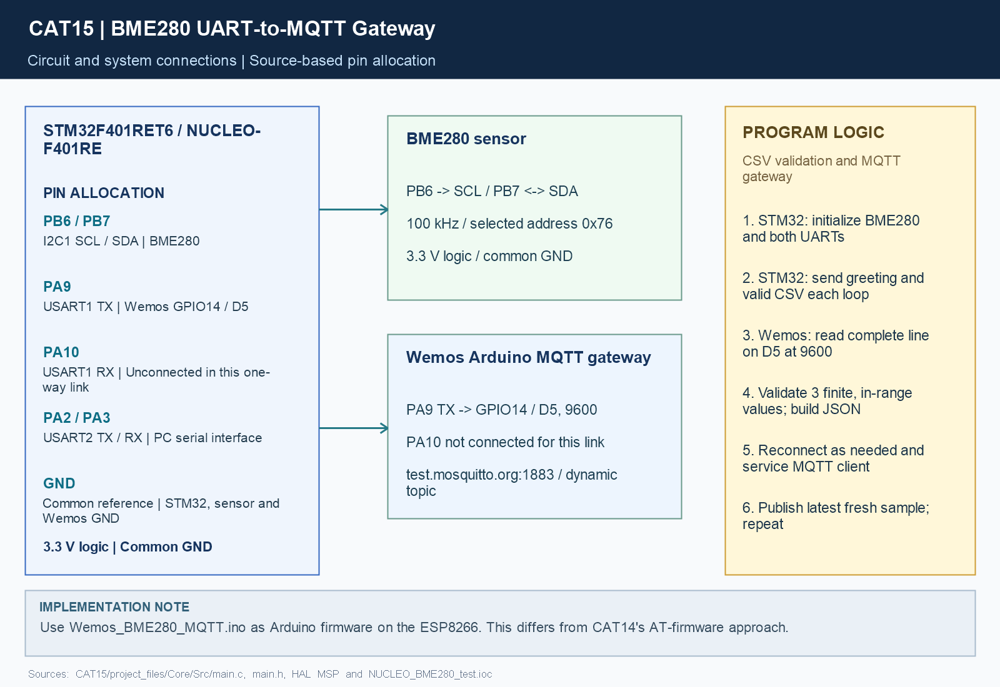

# Continuous Lab Evaluation 15: BME280 UART-to-MQTT Gateway

## 1. Overview

Combines the STM32 BME280 CSV sender with a Wemos Arduino sketch that validates each line, converts it into JSON, and publishes MQTT. The uploaded files implement environmental telemetry; they do not contain ToF distance acquisition.

## 2. Objective

- STM32: initialize BME280 and both UARTs.
- STM32: send greeting and valid CSV each loop.
- Wemos: read complete line on D5 at 9600.

## 3. Hardware and Software Used

- STM32F401RET6 / NUCLEO-F401RE
- ST-LINK or onboard ST-LINK programmer
- USB cable and connections shown in the pin table
- BME280 breakout with compatible 3.3 V logic; I2C pull-ups provided by module or external circuit
- ESP8266/Wemos board with a stable supply appropriate to its power input
- STM32CubeMX and Keil MDK-ARM; see the [detailed report](project_files/README.md) for build setup.

## 4. Main Peripherals Used

| Pin | Function | Connection | Purpose |
|---|---|---|---|
| PB6 / PB7 | I2C1 SCL / SDA | BME280 | 100 kHz; selected address 0x76 |
| PA9 | USART1 TX | Wemos GPIO14 / D5 | 9600 baud receive-only SoftwareSerial |
| PA10 | USART1 RX | Unconnected in this one-way link | Configured but unused |
| PA2 / PA3 | USART2 TX / RX | PC serial interface | 115200 8N1 |
| GND | Common reference | STM32, sensor and Wemos GND | Required shared reference |
| GND | Ground | All connected devices | Common logic reference |

## 5. Summary of Actual Implementation

The STM32 probes sensor addresses but selects 0x76, configures normal mode, and sends a greeting plus CSV about once per second on USART1 at 9600. CSV is also mirrored to USART2 at 115200. Wemos receives on GPIO14/D5, rejects the greeting and malformed lines, requires three finite values within the programmed ranges, and constructs JSON. It connects to test.mosquitto.org:1883, forms a chip-ID-based client/topic, services mqtt.loop(), and publishes the latest pending fresh sample. Wi-Fi and broker retries run at 15 s and 5 s intervals respectively.

## 6. Circuit and Pin Reference

[Open circuit diagram](circuit.png)

System clock: HSI-derived 84 MHz PLL clock; APB1 42 MHz and APB2 84 MHz.

## 7. Links to Artifacts and Detailed Documentation

- [Circuit Diagram](circuit.png)
- [Firmware Flowchart](project_files/flowchart.png)

- [Detailed Project Engineering Report](project_files/README.md)
- [Primary Application Source](project_files/Core/Src/main.c)
- [STM32CubeMX Configuration](project_files/NUCLEO_BME280_test.ioc)
- [Keil Project](project_files/MDK-ARM/NUCLEO_BME280_test.uvprojx)
- [Wemos Arduino MQTT Firmware](project_files/Wemos_BME280_MQTT.ino)

## 8. Key Observations

- Use Wemos_BME280_MQTT.ino as Arduino firmware on the ESP8266. This differs from CAT14's AT-firmware approach.
- The receive-only SoftwareSerial pin is GPIO14 (D5 on D1 mini), not the Wemos hardware RX pin. No Wemos TX-to-PA10 wire is required.
- The STM32 driver remains fixed at 0x76 and can stop retrying reads after rslt becomes an error.
- Only the latest pending reading is kept; samples older than 5 seconds are dropped. MQTT reconnection clears pending data and resynchronizes serial input.
- The sketch contains configured Wi-Fi values; documentation omits them. No Node-RED flow or ToF driver is present in the uploaded task.

## 9. Learning Outcomes

- Explain the pin assignments and the program sequence from the actual source.
- Distinguish configured peripherals from those used in the application loop.
- Compare physical output with the [expected behavior](project_files/README.md#14-expected-output).

## 10. Verification Note

Source and configuration were inspected; the firmware was not rebuilt or tested on a board during this documentation update. Diagrams describe code-based connections and explicitly noted hardware assumptions.

## 11. Conclusion

Wemos USB serial at 115200 prints `Subscribe to: stm32-demo/nucleo-bme280-<chipid>/readings`. Subscribe to that exact topic on the configured broker. JSON keys are `temperature_c`, `pressure_hpa`, and `humidity_percent`; successful publication prints `Published`.
