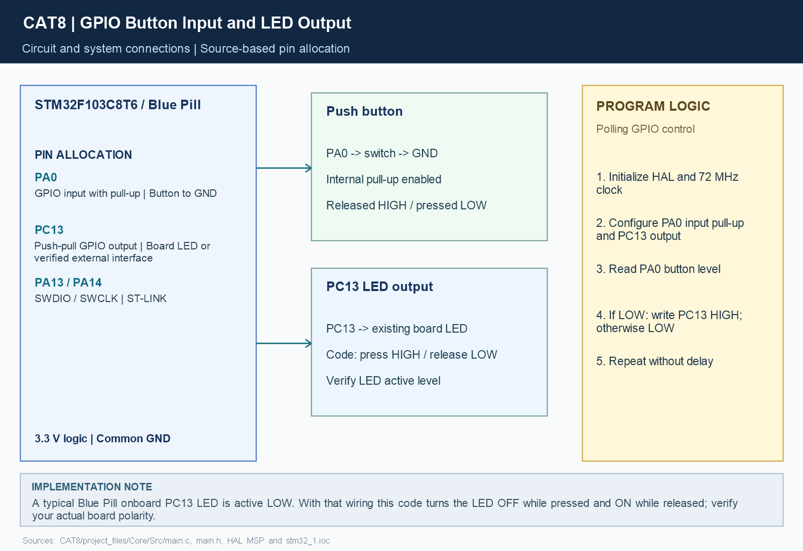

# Continuous Lab Evaluation 8: GPIO Button Input and LED Output

## 1. Overview

Polls an active-LOW button on PA0 and writes its inverse logic level to PC13. There is no debounce, toggle latch or press-duration classification in the uploaded source.

## 2. Objective

- Initialize HAL and 72 MHz clock.
- Configure PA0 input pull-up and PC13 output.
- Read PA0 button level.

## 3. Hardware and Software Used

- STM32F103C8T6 / Blue Pill
- ST-LINK or onboard ST-LINK programmer
- USB cable and connections shown in the pin table
- STM32CubeMX and Keil MDK-ARM; see the [detailed report](project_files/README.md) for build setup.

## 4. Main Peripherals Used

| Pin | Function | Connection | Purpose |
|---|---|---|---|
| PA0 | GPIO input with pull-up | Button to GND | LOW when pressed |
| PC13 | Push-pull GPIO output | Board LED or verified external interface | HIGH on press, LOW on release |
| PA13 / PA14 | SWDIO / SWCLK | ST-LINK | Programming |
| GND | Ground | All connected devices | Common logic reference |

## 5. Summary of Actual Implementation

HAL_GPIO_ReadPin() checks PA0 continuously. GPIO_PIN_RESET causes PC13 to be written SET; any other state writes RESET. The internal pull-up is enabled for PA0.

## 6. Circuit and Pin Reference

[Open circuit diagram](circuit.png)

System clock: HSE 8 MHz × 9 = 72 MHz; APB1 36 MHz, APB2 72 MHz.

## 7. Links to Artifacts and Detailed Documentation

- [Circuit Diagram](circuit.png)
- [Firmware Flowchart](project_files/flowchart.png)

- [Detailed Project Engineering Report](project_files/README.md)
- [Primary Application Source](project_files/Core/Src/main.c)
- [STM32CubeMX Configuration](project_files/stm32_1.ioc)
- [Keil Project](project_files/MDK-ARM/stm32_1.uvprojx)

## 8. Key Observations

- A typical Blue Pill onboard PC13 LED is active LOW. With that wiring this code turns the LED OFF while pressed and ON while released; verify your actual board polarity.
- The supplied STM32 style reference used PA3. This uploaded project uses PA0, confirmed by main.h and the IOC.
- No debounce is implemented; switch bounce can appear on the output.

## 9. Learning Outcomes

- Explain the pin assignments and the program sequence from the actual source.
- Distinguish configured peripherals from those used in the application loop.
- Compare physical output with the [expected behavior](project_files/README.md#14-expected-output).

## 10. Verification Note

Source and configuration were inspected; the firmware was not rebuilt or tested on a board during this documentation update. Diagrams describe code-based connections and explicitly noted hardware assumptions.

## 11. Conclusion

Pressing the button produces PC13=HIGH; releasing it produces PC13=LOW. Visible LED behavior depends on its polarity.
