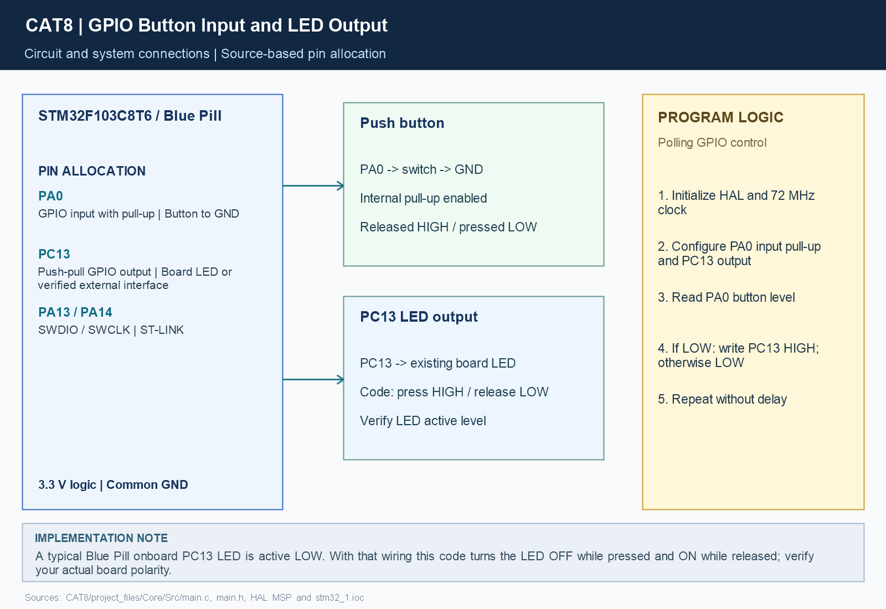
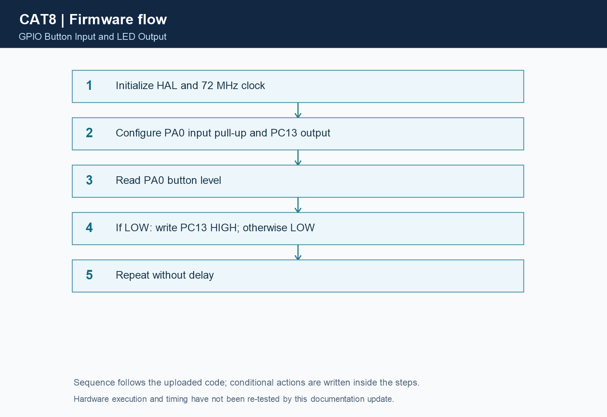

# Continuous Lab Evaluation 8: GPIO Button Input and LED Output

## 1. Experiment Title

GPIO Button Input and LED Output using STM32F103C8T6 / Blue Pill.

## 2. Aim

Polls an active-LOW button on PA0 and writes its inverse logic level to PC13. There is no debounce, toggle latch or press-duration classification in the uploaded source.

## 3. Hardware Components

- STM32F103C8T6 / Blue Pill
- ST-LINK or onboard ST-LINK programmer
- USB cable and connections shown in the pin table

## 4. Software Tools

- STM32CubeMX: `stm32_1.ioc`
- Keil MDK-ARM: `MDK-ARM/stm32_1.uvprojx`
- STM32 HAL and CMSIS sources included in the project

## 5. Theory

GPIO and UART behavior depends on pin mode and active level. A logical HIGH or LOW describes the electrical output; visible LED state also depends on its wiring. HAL calls provide peripheral access while SysTick supplies software timing.

## 6. Actual Pin Configuration

| Pin | Function | Connection | Purpose |
|---|---|---|---|
| PA0 | GPIO input with pull-up | Button to GND | LOW when pressed |
| PC13 | Push-pull GPIO output | Board LED or verified external interface | HIGH on press, LOW on release |
| PA13 / PA14 | SWDIO / SWCLK | ST-LINK | Programming |
| GND | Ground | All connected devices | Common logic reference |

The connections are derived from the source and configuration, rather than a photographed lab assembly. Check board routing and module power pins before wiring. MCU port labels are not connector pin numbers.

## 7. Circuit Diagram



[Open circuit diagram](circuit.png)


## 8. CubeMX / Peripheral Configuration

- System clock: HSE 8 MHz × 9 = 72 MHz; APB1 36 MHz, APB2 72 MHz.
- Configuration: [stm32_1.ioc](stm32_1.ioc).
- Peripheral assignments and operational rates are listed above; the actual initialization in `main.c` is the basis for runtime settings.

1. Open [stm32_1.uvprojx](MDK-ARM/stm32_1.uvprojx) with the matching STM32 device pack installed.
2. Keep `Core/`, `Drivers/`, `MDK-ARM/` and the IOC together. The reorganization preserves these internal relative paths.
3. Check the device and clock settings, build, and review compiler/linker diagnostics. Existing output files may predate the source.
4. Program the intended board using ST-LINK. Make connections from the pin table and confirm the stated logic levels.
5. Compare the observed behavior with the expected output below.

## 9. Key APIs Used

- `HAL_GPIO_ReadPin()`
- `HAL_GPIO_WritePin()`
- `HAL_RCC_OscConfig()`
- `HAL_RCC_ClockConfig()`

## 10. Source Code Logic

HAL_GPIO_ReadPin() checks PA0 continuously. GPIO_PIN_RESET causes PC13 to be written SET; any other state writes RESET. The internal pull-up is enabled for PA0.

Read [main.c](Core/Src/main.c) for the complete implementation.

## 11. Algorithm

1. Initialize HAL and 72 MHz clock.
2. Configure PA0 input pull-up and PC13 output.
3. Read PA0 button level.
4. If LOW: write PC13 HIGH; otherwise LOW.
5. Repeat without delay.

## 12. Pseudocode

```text
1. Initialize HAL and 72 MHz clock
2. Configure PA0 input pull-up and PC13 output
3. Read PA0 button level
4. If LOW: write PC13 HIGH; otherwise LOW
5. Repeat without delay
```

## 13. Flowchart



## 14. Expected Output

Pressing the button produces PC13=HIGH; releasing it produces PC13=LOW. Visible LED behavior depends on its polarity.

## 15. Actual Observations

No new physical test was performed for this update. The behavior described here is inferred from the uploaded source. Add measured readings, terminal captures and board-specific observations after running the project.

## 16. Troubleshooting

1. Check board power, shared GND and the exact MCU port names before interpreting a missing output.
2. Open the matching project and rebuild; do not assume stored build artifacts reflect the current source.
3. If LED response seems inverted, check the PC13 active-LOW wiring and the HIGH-on-press source behavior.

## 17. Limitations and Implementation Notes

- A typical Blue Pill onboard PC13 LED is active LOW. With that wiring this code turns the LED OFF while pressed and ON while released; verify your actual board polarity.
- The supplied STM32 style reference used PA3. This uploaded project uses PA0, confirmed by main.h and the IOC.
- No debounce is implemented; switch bounce can appear on the output.

## 18. Result and Verification

Reviewed against the uploaded `Core/Src/main.c`, `Core/Inc/main.h`, `Core/Src/stm32f1xx_hal_msp.c` and `stm32_1.ioc`. This documentation update does not claim a new Keil build, hardware run, measured waveform or successful network connection.

The uploaded program implements the behavior described above. Hardware success remains to be confirmed against the expected output.

## 19. Viva Questions with Answers

1. **Why enable the pull-up?**  
   It gives PA0 a defined HIGH level when the switch is open.

2. **Why can the LED appear inverted?**  
   An active-LOW LED lights when its pin is LOW, but this code writes HIGH on a press.

3. **Does a press retain the LED state?**  
   No. The output follows the current button reading.

## 20. File Descriptions

| File / folder | Purpose |
|---|---|
| [Core/Src/main.c](Core/Src/main.c) | Main application and peripheral initialization |
| [Core/Inc/main.h](Core/Inc/main.h) | Public declarations and GPIO macros |
| `Core/Src/*hal_msp.c` | Peripheral clocks and alternate-function GPIO setup |
| [stm32_1.ioc](stm32_1.ioc) | STM32CubeMX configuration |
| [MDK-ARM/stm32_1.uvprojx](MDK-ARM/stm32_1.uvprojx) | Keil project |
| `Drivers/` | Included HAL and CMSIS dependencies |

[Return to task overview](../README.md)
